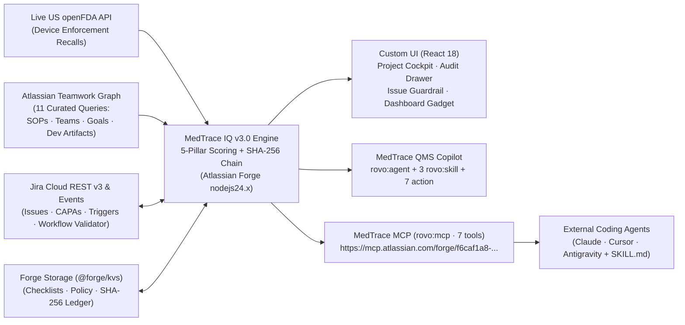

# MedTrace IQ v3.0 — Autonomous FDA 21 CFR 820, ISO 13485 & 21 CFR Part 11 Regulatory Governance Engine for Atlassian

> **Codegeist 2026: "Build with context. Ship with confidence."**
> **Category:** Apps for Specialized Industries (Healthcare, MedTech & Life Sciences)
> **Bonus Integrations (All 4):** Rovo Agent + Reusable Rovo Skills (`rovo:agent`, `rovo:skill`, 7 `action`) · Atlassian Rovo MCP (`rovo:mcp` + `SKILL.md`) · Atlassian Teamwork Graph Curated Queries (`requestTeamworkGraph`) · Atlassian Marketplace Free Listing

---

## Why MedTrace IQ?

Medical device, diagnostics, and biotech teams manage design controls in **Jira**, Standard Operating Procedures (SOPs) and Design History Files (DHFs) in **Confluence**, and quality complaints in **Jira Service Management**. Yet releases still stall—or fail FDA audits—because critical regulatory context is fragmented across silos:

- An engineer creates or updates an infusion-pump firmware ticket in Jira without realizing a **live US FDA Class I recall** just hit the exact same occlusion failure mode.
- A release manager transitions a ticket to **Done / Released** even though ISO 14971 risk verification or QA sign-off is missing.
- A change modifies a safety parameter without surfacing the real Confluence SOP owner discovered via **Atlassian Teamwork Graph**.
- FDA inspectors ask for **21 CFR Part 11** tamper-evident electronic signature proof and Design History File (DHF) traceability, triggering weeks of manual spreadsheet assembly.

**MedTrace IQ v3.0** unifies **Jira**, **Autonomous Forge Triggers**, **Physical Jira Workflow Validators**, **Executive Dashboard Gadgets**, **Atlassian Teamwork Graph**, **Rovo Agents & Skills**, **Rovo MCP**, **SHA-256 21 CFR Part 11 Cryptography**, and **live US openFDA Medical Device Enforcement data** into a single 100% native Forge platform—so MedTech teams truly **build with context and ship with confidence**.

---

## Key Capabilities (v3.0 Platinum Architecture)

### 1. Autonomous Background openFDA Trigger Monitor (`trigger`)
Listens to `avi:jira:created:issue` and `avi:jira:updated:issue` in the background (with loop prevention via `event.selfGenerated` and per-`(issue, recall)` KVS deduplication). When an engineer creates or updates a ticket touching a regulated medical subsystem with an active **FDA Class I** recall parallel, MedTrace IQ **autonomously**:
- Applies the `medtrace-fda-hold` label via `api.asApp()`
- Posts a structured ADF safety alert comment citing the exact FDA recall number, firm, and failure mode
- Appends an immutable, **SHA-256 hash-chained** `AUTONOMOUS_FDA_ALERT` entry to the project audit ledger

### 2. Physical Jira Workflow Release Gate (`jira:workflowValidator`)
Real compliance enforcement—not just advisory dashboards. Add **MedTrace IQ FDA/ISO Release Gate** to any Jira workflow transition (supports both **Company-Managed** and **Team-Managed** projects). If a work item's deterministic Ship-Confidence verdict is not `SHIP_READY`, Jira physically **blocks the release transition** and reports the exact score and top blocking compliance gap.

### 3. FDA 21 CFR Part 11 SHA-256 Tamper-Evident Audit Chain
Every QA Regulatory Sign-Off and Autonomous FDA Alert is cryptographically linked (`SHA-256(previousHash | id | eventType | projectKey | issueKey | decision | actor | timestamp | rationale)`) into a verifiable hash chain persisted in Forge Storage (`@forge/kvs`) and written back onto Jira comments with full SHA-256 digests. Auditors, QA leads, Rovo Copilot, and external MCP agents can run **`verify-audit-chain`** at any time to prove zero post-hoc tampering—or export machine-readable **JSON (`21cfr11-evidence-pack.v3`)** and **Markdown DHF Audit Packs**.

### 4. Executive Release Readiness Dashboard Gadget (`jira:dashboardGadget`)
Drop **MedTrace IQ Executive Release Readiness** onto any Jira Dashboard for VP QA / Executive leadership visibility—featuring live project selector configuration, radial Ship-Confidence gauge, Ready/Conditional/Hold counts, Class I exposure badge, and 21 CFR Part 11 SHA-256 integrity status.

### 5. Interactive Release Cockpit, 3×3 Risk Heatmap & Per-Gate What-If Simulator (`jira:projectPage`)
- **ISO 14971 Risk × Release Verdict Matrix:** Interactive 3×3 executive heatmap (`Critical / High / Moderate` × `HOLD / CONDITIONAL / SHIP READY`) that cross-filters the release gate table on click.
- **Real Semantic FDA 21 CFR 820.30 Rubric & 16 Regulated Device Subsystems:** Classifies 16 clinical device categories (Infusion Pump, Pacemaker, Ventilator, Catheter, CGM, Defibrillator, Imaging, Surgical Robotics, Dialysis, Anesthesia, Pulse Oximeter, Neurostimulator, Orthopedic Implant, IVD Diagnostics, Sterilizer, Ophthalmic Laser), verifies 4 explicit 820.30 specification criteria (standard citation, quantitative tolerances, hazard controls, protocol references — never gamed by filler text), and scores **Direct Failure-Mode Overlap** against live openFDA recalls.
- **Native `<dialog>` Slide-Over Issue Audit Drawer + Interactive Per-Gate What-If Simulator:** Inspect any issue directly from the cockpit, toggle individual open controls (`+15 V&V`, `+6 ISO 14971`, `+10 SOP Owner`, `+18 openFDA Clear`, `+10 QA Approval`) to simulate exact score deltas and release verdict transitions, view auto-matched Teamwork Graph Confluence SOPs and live openFDA recalls, and persist live ISO 13485 gate checklists to Forge KVS.
- **Zero-Overlap 4-Column Blast-Radius & Teamwork Graph Topology:** Visualizes `Live openFDA Recalls` (with animated pulse alerts on active Class I signals) → `Jira Design Controls & CAPAs` → `TWG Confluence SOPs` → `TWG Teams & Goals` with semantic `TWG_GOVERNS_SOP` edges and click-to-inspect provenance.
- **Balanced 1-Click Judge Demo Seeder:** Populates realistic `Ship Ready`, `Conditional`, and `Regulatory Hold` regulated MedTech work items in seconds so evaluators immediately experience full Green/Amber/Red executive gating.

### 6. Contextual Jira Issue Guardrail (`jira:issuePanel`)
Lives directly inside every Jira ticket: displays radial Ship-Confidence gauge, 5-pillar bars, interactive ISO 13485 checklist, auto-matched Teamwork Graph Confluence SOP cards, matched openFDA recalls, 21 CFR Part 11 SHA-256 sign-off digest, 1-click Linked CAPA creation, and 1-click launch of **MedTrace QMS Copilot** via `@forge/bridge` `rovo.open()`.

### 7. Rovo Agent + 3 Reusable Skills + Rovo MCP Server (7 Tools)
- **`rovo:agent` (`MedTrace QMS Copilot`)** + **3 modular `rovo:skill` playbooks** (`fda-recall-impact`, `capa-triage`, `dhf-audit-check` with `references/` rubrics) + **7 executable Forge actions**:
  1. `get-project-readiness`
  2. `analyze-issue-compliance`
  3. `search-fda-recalls`
  4. `query-teamwork-graph-context`
  5. `create-capa-ticket`
  6. `record-regulatory-signoff`
  7. `verify-audit-chain`
- **`rovo:mcp` (`MedTrace MCP`):** Exposes all 7 regulatory tools to Rovo Studio and external MCP coding agents (Claude Code, Cursor, Antigravity, VS Code) via OAuth 2.1:
  ```
  https://mcp.atlassian.com/forge/f6caf1a8-53e4-49e6-8e26-f98807c8151c
  ```
  Pair with [SKILL.md](./SKILL.md) for automated pre-merge FDA release gating in your IDE.

### 8. Live Atlassian Teamwork Graph Integration
Executes 11 typed **Teamwork Graph Curated Queries** via `api.asUser().requestTeamworkGraph()` (`echo`, `atlassianTeamsBySpace`, `atlassianUserInTeams`, `jiraSpaceWorkItems`, `jiraWorkItemGoals`, `jiraWorkItemComments`, `jiraWorkItemDevelopmentArtifacts`, `jiraWorkItemHierarchy`, `atlassianUserContent`, `atlassianUserGoalsAndProjects`, `confluencePageLinkedConfluencePages`) with real-time per-query telemetry.

---

## Architecture, Forge Native Storage & Zero-PII Privacy



- **100% native Atlassian Forge** (`nodejs24.x` ARM64 runtime + `@forge/kvs` + Custom UI React 18).
- **Zero customer data or PII ever leaves Atlassian Cloud** — openFDA calls strictly pass generic medical device category keywords (e.g. `"infusion pump"`, `"pacemaker"`), declared with `inScopeEUD: false`. See [PRIVACY.md](./PRIVACY.md).

---

## Development & Deployment

```bash
# 1. Install backend & Custom UI dependencies
npm install
cd static/ui && npm install && npm run build && cd ../..

# 2. Run unit tests (11/11 covering 16 subsystems, 820.30 anti-gaming rubric, failure-mode matching, SOP linking, analytics, and SHA-256 tamper detection)
npm test

# 3. Validate Forge manifest, Rovo skills, MCP server, triggers, validator & scopes
forge lint

# 4. Deploy & install to your Jira Cloud site
forge deploy
forge install --product jira
```

## License
Apache License 2.0 — see [LICENSE](./LICENSE).
